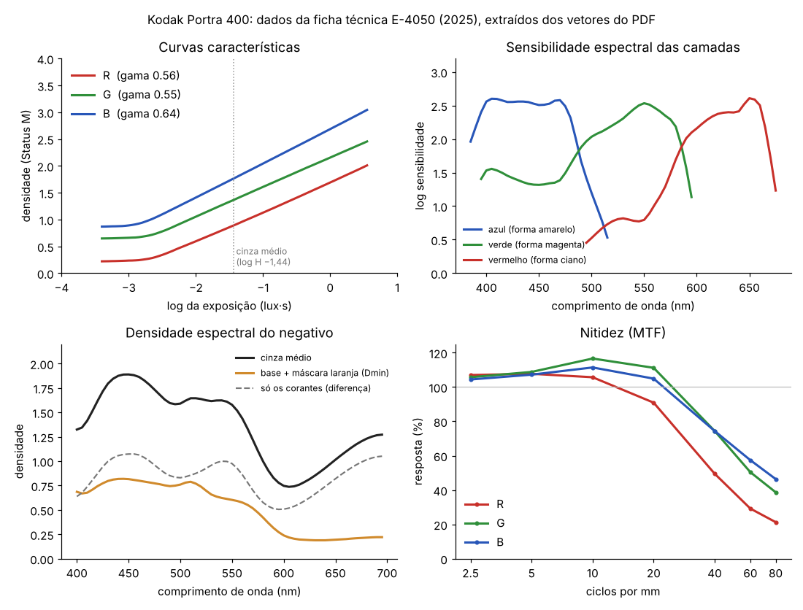
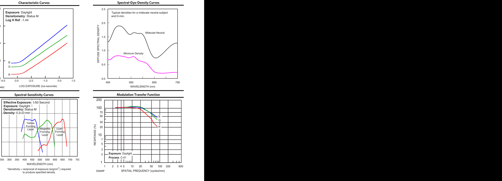
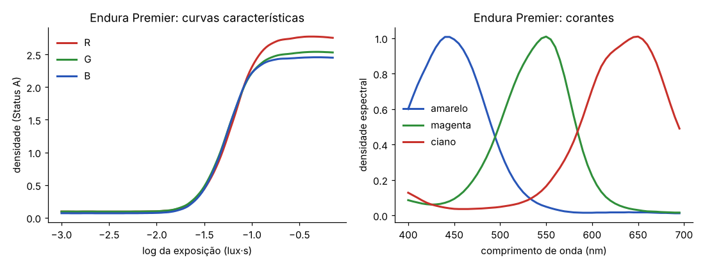
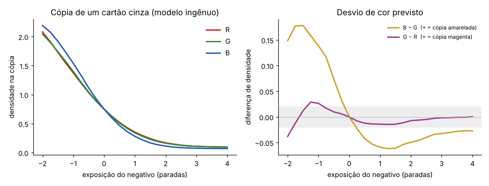

# Dossiê: Kodak Portra 400

> Primeiro dossiê da pesquisa de filmes do Revela, e molde para os próximos.
> Separa sempre **o que a ficha técnica diz** (dado medido pelo fabricante), **o que eu leio desses dados** (interpretação) e **o que fotógrafos e laboratórios relatam** (observação de uso).



## 1. Resumo

O Portra 400 é um negativo colorido de **contraste baixo e latitude enorme**. A latitude é a margem de erro de exposição que o filme aceita sem estragar a foto. A ficha mostra a resposta ainda em linha reta **6,6 paradas acima** do cinza médio (o gráfico acaba antes de a curva dobrar). Para baixo, a resposta começa a se comprimir **3,5 paradas abaixo**.

As camadas de cor têm sensibilidades bem separadas e cortes abruptos. A camada sensível ao vermelho cai depressa depois de 660 nm, o que segura o exagero nos vermelhos e laranjas e ajuda a pele.

O vermelho é visivelmente menos nítido que o verde e o azul.

O "visual Portra" que as pessoas conhecem hoje é o do **negativo escaneado** num Frontier ou Noritsu (os dois scanners de laboratório mais comuns), e menos o da cópia em papel.

## 2. Identidade

| | |
|---|---|
| Fabricante | Kodak (hoje distribuído pela Kodak Alaris) |
| Tipo | Negativo colorido, processo **C-41** (a revelação padrão de negativo colorido) |
| Sensibilidade | ISO 400 com luz do dia. Com filtro: 125 (lâmpada 3400 K) ou 100 (tungstênio 3200 K) |
| Formatos | 135, 120 e chapas. Base de poliéster ESTAR de 0,10 mm |
| Tecnologia declarada | Tecnologia de filme de cinema KODAK VISION; grãos T-GRAIN; "sensibilização por antena" nas camadas ciano e magenta; acopladores DIR (químicos que limitam a revelação ao redor de cada ponto e aumentam a nitidez e a separação de cores) |
| Feito para | Pele, moda, retrato; "ideal para escaneamento" (palavras da ficha) |
| Papel recomendado | KODAK PROFESSIONAL ENDURA Premier (e variantes) |

## 3. A cadeia: da cena à foto

```
cena ──► NEGATIVO (C-41) ──┬──► cópia em papel (ampliador + Endura, RA-4)   ← o caminho da ficha
                           └──► ESCANEAMENTO (Frontier, Noritsu)            ← o caminho mais comum hoje
```

A ficha descreve o negativo e o papel. O escaneamento não tem documentação pública. Cada laboratório inverte e equilibra o negativo com o algoritmo do scanner, e a "cara" do Portra que circula hoje depende muito dessa etapa (seção 7).

**Consequência para o Revela:** o motor precisa simular o negativo com fidelidade e, depois, oferecer uma saída de escaneamento (e, no futuro, a de papel).

## 4. O que a ficha técnica diz

Os dados foram extraídos dos vetores do PDF, não digitalizados à mão. A conferência abaixo sobrepõe os dados extraídos (em cor) ao gráfico original (em preto): eles coincidem.



Arquivo com todos os números: [`../dados/portra400.json`](../dados/portra400.json).

### 4.1 Curvas características

São as curvas que dizem quanta densidade (escurecimento do negativo) cada exposição produz, em cada camada.

| Canal | Densidade da base (Dmin) | Gama (inclinação) | Densidade no cinza médio | Pé começa em |
|---|---|---|---|---|
| R | 0,22 | **0,56** | 0,89 | log H −2,50 |
| G | 0,65 | **0,55** | 1,36 | log H −2,55 |
| B | 0,87 | **0,64** | 1,76 | log H −2,70 |

O cinza médio de referência está em log H −1,44. A densidade é medida em Status M, o padrão de densitômetro para negativos.

**Leitura:**
- **Gama ~0,55 é contraste baixo.** É isso que dá a suavidade e a latitude. O contraste final da foto vem do papel ou do scanner, não do negativo.
- **Faixa útil:** do pé (−2,5) até o fim do gráfico (+0,56) são 3,06 unidades de log, cerca de **10 paradas** em linha reta. Em relação ao cinza médio: **3,5 paradas para baixo** até as sombras começarem a se comprimir, e **mais de 6,6 para cima** sem sinal de "ombro" (o achatamento que, em outros filmes, estoura as luzes). Isso explica por que o Portra aguenta tanta superexposição.
- **O azul tem gama maior (0,64).** Isso **não** quer dizer que a foto puxe para o azul ou o amarelo. Parte da leitura de azul em Status M vem da absorção "indesejada" do corante magenta no azul. A seção 8 mostra o erro de tomar esse número ao pé da letra.

### 4.2 Sensibilidade espectral das camadas

Mostra a que cores de luz cada camada responde. A escala é logarítmica: 1 unidade a menos equivale a 10 vezes menos sensível.

| Camada | Pico | Faixa principal | Observação |
|---|---|---|---|
| Azul (forma o corante amarelo) | ~405–470 nm, planalto | até ~490 nm | Corte abrupto entre 480 e 515 nm |
| Verde (forma o magenta) | **550 nm** | ~500–590 nm | Tem uma **segunda sensibilidade ao azul**, ~1 log abaixo do pico (cerca de 10%), em 400–470 nm |
| Vermelho (forma o ciano) | **650 nm** | ~600–670 nm | Corte forte depois de 660 nm; pequeno "ombro" em 520–545 nm, ~1,7 log abaixo (cerca de 2%) |

**Leitura:**
- O **corte do vermelho depois de 660 nm** faz o filme "ver" pouco do vermelho profundo. Vermelhos e laranjas (e a pele) não saturam demais. É um traço de filme de retrato.
- A **sensibilidade secundária do verde ao azul** e o **ombro do vermelho no verde** são sobreposições entre camadas. Elas fazem parte de como o filme mistura as cores, e é aqui que mora a "separação de cores" que o RNI tanto valoriza. Um modelo que trata os três canais como independentes perde isso por completo. **É exatamente a limitação do motor atual do Revela.**

### 4.3 Densidade espectral do negativo

| Comprimento de onda | 450 nm | 550 nm | 650 nm |
|---|---|---|---|
| Base + máscara laranja (Dmin) | 0,82 | 0,60 | 0,20 |
| Só os corantes (cinza médio − Dmin) | 1,07 | 0,98 | 0,82 |

**Leitura:**
- A Dmin alta no azul e no verde e baixa no vermelho **é a máscara laranja** do negativo. Ela vem de acopladores que corrigem as absorções indesejadas dos corantes.
- Os corantes, descontando a base, têm picos perto de 450 nm (amarelo), 540 nm (magenta) e acima de 690 nm (ciano). **A ficha não publica a curva de cada corante separado**, só a soma no cinza médio. Separar essa soma (o que os simuladores chamam de *unmixing*, desmisturar) é um dos trabalhos que faltam (seção 9).

### 4.4 Nitidez (MTF)

A MTF mede quanto contraste o filme preserva em detalhes cada vez mais finos. 100% é perfeito.

| ciclos/mm | 10 | 20 | 40 | 80 |
|---|---|---|---|---|
| R | 106% | 91% | **50%** | 21% |
| G | 117% | 111% | 74% | 39% |
| B | 111% | 105% | 74% | 46% |

**Leitura:**
- **Acima de 100% em detalhes médios:** é o efeito de borda dos acopladores DIR. Eles reforçam o contraste nos contornos, como uma nitidez local natural.
- **O vermelho é bem mais macio** (50% contra 74% em 40 ciclos/mm). O vermelho é a camada mais funda, e a luz se espalha antes de chegar nela. O mesmo motivo explica por que a **halação** (o brilho em volta das luzes fortes) é avermelhada.
- **Para o motor:** aplicar nitidez por canal, com o vermelho mais suave e um leve reforço de contorno no verde e no azul.

### 4.5 Grão

A ficha usa o **Print Grain Index**: 25 é o limite em que o grão começa a ser visível, e 4 pontos equivalem a uma diferença que se percebe.

| Negativo | 10×15 cm | 20×25 cm | 40×50 cm |
|---|---|---|---|
| 35 mm | **37** | 59 | 89 |
| 6×6 (120) | 25 | 37 | 59 |
| 4×5" | < 25 | < 25 | 36 |

**Leitura:** em 35 mm, o grão já aparece numa cópia 10×15 e fica forte em ampliações. Em médio formato, numa 10×15, fica no limite do visível. O motor de grão do Revela, que já considera o formato do quadro, pode ser calibrado com esses números.

### 4.6 Medidas de referência

| Área medida (densidade no canal vermelho) | Densidade |
|---|---|
| Cartão cinza Kodak | 0,77–0,87 |
| Testa bem iluminada, pele clara | 1,08–1,18 |
| Testa bem iluminada, pele escura | 0,93–1,03 |

Servem de **pontos de conferência** do modelo: um cinza e uma pele simulados devem cair nessas faixas.

## 5. O papel: Kodak Endura Premier



Dados em [`../dados/endura_premier.json`](../dados/endura_premier.json), da publicação E-4070 (2017).

| Canal | Dmin | Dmax | Gama máximo |
|---|---|---|---|
| R | 0,09 | 2,77 | 4,8 |
| G | 0,09 | 2,54 | 4,4 |
| B | 0,07 | 2,46 | 4,5 |

Os picos dos corantes do papel ficam em 440 nm (amarelo), 550 nm (magenta) e 650 nm (ciano).

**Leitura:** o papel tem contraste altíssimo (gama ~4,5) e curva em "S". É ele que transforma o negativo suave numa foto com preto profundo e branco limpo. O desenho dessa curva decide como as luzes "rolam" para o branco e as sombras para o preto.

## 6. Comportamento observado na prática

Estes relatos vêm de fotógrafos e laboratórios. São úteis, mas não são medições.

| Situação | O que se observa | Fonte |
|---|---|---|
| Latitude | Cor aceitável de −1 a +3 EV; em cópias equilibradas para a pele, quase sem diferença de cor entre −1 e +3/+4 paradas | Dehancer; 35mmc |
| Limite | A latitude para cima existe, mas tem fim: num teste de +9 paradas os dados se desfazem | Photrio |
| +1 parada | Pele mais luminosa, luzes mais claras, sombras abertas. Muitos fotometram a ISO 200 de propósito | Carmencita Film Lab; relatos de uso |
| Superexposto | Tende a luzes amarelo-esverdeadas e sombras cianas | Dehancer |
| Subexposto | Luzes avermelhadas (ruim para pele clara), sombras frias | Dehancer |
| Pele | Quente e lisonjeira em pele clara; pode ficar laranja demais em pele escura ou do leste asiático | Mastin Labs (fonte comercial) |
| Scan no Frontier | Mais frio, sombras ciano e azuis, pretos mais densos, pele mais dourada, cor mais saturada | Laboratórios (Carmencita e outros) |
| Scan no Noritsu | Mais faixa tonal, menos contraste e saturação | Laboratórios |
| Scan caseiro | Mais "chato" que o de laboratório: mais faixa tonal, menos diferença entre os tons | Mastin Labs |

**Leitura:** as mudanças de cor com a exposição (amarelo-verde superexposto, vermelho subexposto) **não aparecem** nas curvas características vistas canal a canal. Elas vêm da interação entre as camadas, das máscaras e do equilíbrio que o laboratório faz em cada foto. Mais um motivo para o modelo espectral.

## 7. O escaneamento (Frontier e Noritsu)

- **Não há documentação técnica pública** dos algoritmos de inversão desses scanners. O que existe são comparações de laboratórios.
- O Frontier usa iluminação por LED RGB e aplica a "ciência de cor" própria. O resultado é contraste mais alto e luzes mais perto de estourar.
- O Noritsu prioriza a faixa tonal.
- **Para o Revela:** a etapa de escaneamento será um modelo próprio, ajustado por comparação com scans reais (ver seção 9). Faz sentido oferecer duas leituras, uma "de laboratório tipo Frontier" e uma "mais aberta tipo Noritsu", desde que calibradas com material de verdade.

## 8. Primeira simulação, e por que ela falha

Testei o caminho mais simples: usar as curvas características (Status M) como se fossem o que o papel "vê", com a filtragem do ampliador fixa e equilibrada para o cinza médio. Daí, "copiar" um cartão cinza exposto de −2 a +4 paradas.



| Exposição | −2 | −1 | 0 | +1 | +2 | +3 |
|---|---|---|---|---|---|---|
| Desvio B − G na cópia | +0,15 | +0,14 | 0 | −0,06 | −0,05 | −0,03 |

O modelo prevê **sombras amareladas e luzes azuladas**, com desvio de até 0,15 de densidade, bem visível. Isso **contradiz** o que se observa (seção 6) e o que a Kodak promete (cinza neutro numa faixa ampla).

**Por que falha:**
1. A **densidade Status M não é a densidade de cópia.** O papel enxerga o negativo pela própria sensibilidade espectral (seção 5), não pelos filtros do densitômetro.
2. A leitura de azul inclui a **absorção indesejada do corante magenta**, que a máscara laranja compensa. O modelo canal a canal não sabe disso.
3. Faltam os **efeitos entre camadas** (acopladores DIR).

**Conclusão:** essa é a prova, com os dados do próprio Portra, de que **um modelo canal a canal (como o motor atual do Revela) não chega à fidelidade do RNI**. O caminho certo é espectral: luz da cena → sensibilidade de cada camada → curvas → corantes separados → papel ou scanner. O autor do spektrafilm, o simulador aberto mais completo, chega à mesma conclusão: "as curvas da ficha não bastam".

## 9. O que falta, e como obter

| Lacuna | Por que importa | Como preencher |
|---|---|---|
| Curva de cada corante (C, M, Y) separada | Sem ela não há densidade de cópia correta nem separação de cores | Desmisturar a curva do cinza médio com a restrição de que um cinza deve sair cinza em qualquer exposição; conferir com corantes publicados de filmes parecidos (a Fuji publica os dela) |
| Máscara e acopladores DIR (intensidade) | Saturação e cruzamentos de cor com a exposição | Ajustar contra fotos reais (abaixo) |
| Densidade de cópia | Liga negativo e papel | Calcular a partir da densidade espectral e da sensibilidade do papel (já extraída) |
| Resposta do scanner | É a cara que as pessoas conhecem | Ajustar com pares de scans reais |
| **Fotos de referência reais** | Única prova final de fidelidade | Ver abaixo |

### O pedido mais importante: um rolo de referência

Sem isso, o modelo fica correto na física, mas sem prova.

1. Um rolo de **Portra 400** fotografando uma **cartela de cores** (ColorChecker, um cartão com 24 quadrados de cor padronizada) e uma pessoa. Fazer uma foto em cada exposição: −2, −1, 0, +1, +2, +3 paradas, sempre com a mesma luz.
2. A **mesma cena em digital** (RAW), com a mesma luz e na mesma hora.
3. Revelação C-41 e **scan num Frontier e num Noritsu**, sem correção manual se o laboratório permitir.

Com isso dá para medir o erro de cor do modelo em cada quadrado (ΔE, a medida padrão de diferença de cor) e ajustar até ficar abaixo do perceptível.

## 10. Plano de modelagem para o Revela

1. **Entrada em luz linear:** converter a foto para luz da cena antes de qualquer corte no branco.
2. **Exposição de cada camada:** estimar o espectro de cada cor RGB (*spectral upsampling*) e integrar com as sensibilidades da seção 4.2.
3. **Revelação:** curvas características (4.1), com um termo de interação entre camadas (acopladores DIR).
4. **Corantes:** densidade espectral do negativo, com corantes separados e máscara (4.3).
5. **Saída:** "escaneamento" (inversão e equilíbrio calibrados nos scans de referência) ou "cópia" (densidade de cópia → curvas do Endura → corantes do papel).
6. **Empacotar como LUT 3D:** o resultado vira uma tabela de cor 65×65×65, mais os parâmetros de grão, nitidez por canal e halação. No celular, roda tão rápido quanto hoje.
7. **Validação:** cinza neutro de −1 a +3 paradas; cartão cinza e pele nas densidades da seção 4.6; ΔE contra o rolo de referência.

O cálculo espectral pesado é feito **uma vez**, no computador, para gerar a LUT. O app só aplica a tabela, e é por isso que o desempenho não muda.

## Fontes

**Fichas técnicas (dados medidos):**
- [Kodak Portra 400, E-4050 (jan. 2025)](https://www.freestylephoto.com/static/pdf/product_pdf/kodak/e4050_Kodak_Portra_400.pdf)
- [Kodak Endura Premier, E-4070 (dez. 2017)](https://business.kodakmoments.com/sites/default/files/files/products/e4070.pdf)

**Simulação de filme (métodos):**
- [spektrafilm, antigo agx-emulsion (README)](https://hn.jakechampion.name/reader/https://github.com/andreavolpato/spektrafilm): código GPLv3, dados CC BY-SA 4.0. Lido como referência de método; nada copiado.
- [Spectral film simulations from scratch (pixls.us)](https://discuss.pixls.us/t/spectral-film-simulations-from-scratch/48209)
- [spektrafilm no darktable (manual)](https://docs.darktable.org/usermanual/development/en/module-reference/processing-modules/spektrafilm/)

**Comportamento observado:**
- [Dehancer: Kodak Portra 400 em diferentes exposições](https://www.dehancer.com/learn/articles/Kodak-Portra-400-Exposure-test)
- [35mmc: Overexposure latitude](https://www.35mmc.com/02/05/2016/overexposure-latitude)
- [Carmencita Film Lab: How Exposure Affects Film](https://carmencitafilmlab.com/?p=4700)
- [Photrio: limites da superexposição](https://www.photrio.com/forum/goto/post?id=2932313)
- [Mastin Labs: Portra 400 no Lightroom](https://mastinlabs.com/blogs/photoism/blog-portra-400-lightroom-authentic-look) (fonte comercial)
- [Carmencita: Frontier vs Noritsu, round 2](https://carmencitafilmlab.com/?p=35292)
- [The Art of Film Scanning: Frontier vs. Noritsu](https://jbflanc.substack.com/p/the-art-of-film-scanning-frontier)
