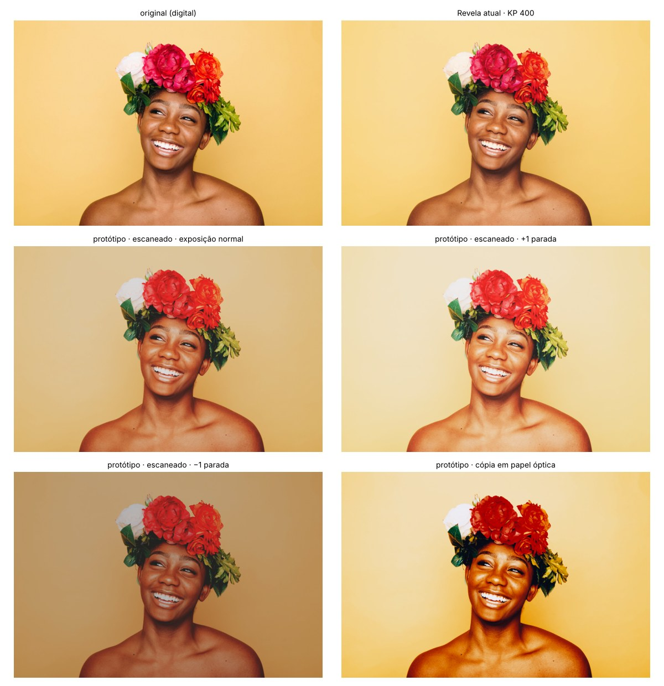
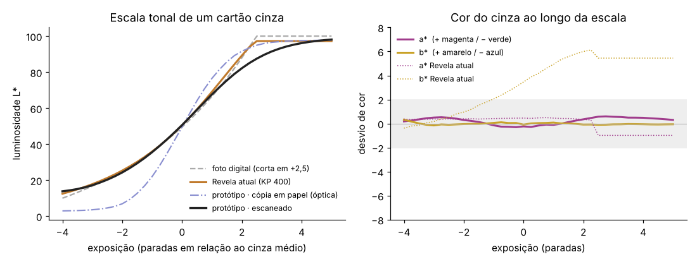
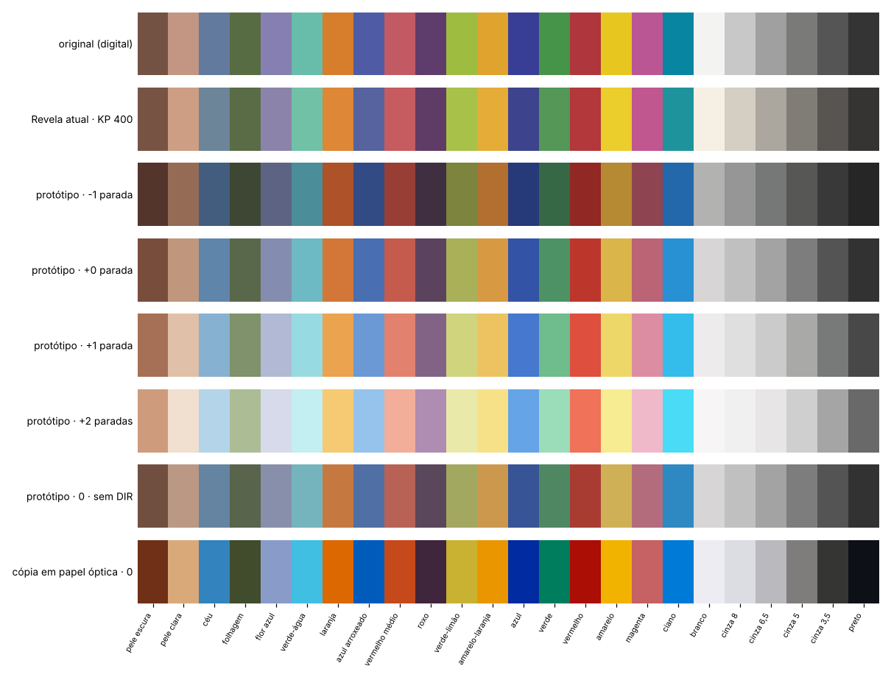
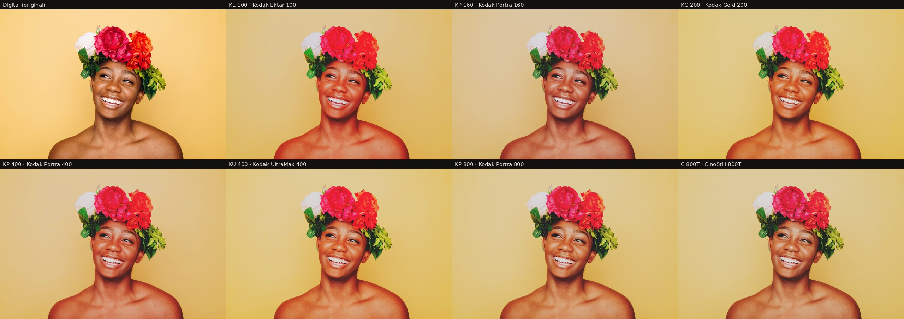

# Motor espectral dos filmes

> **Atualização (14/11, versão 2):** o motor agora gera os **7 negativos Kodak** do app novo. Três mudanças, explicadas na seção "Versão 2" no fim deste arquivo:
> (1) forma real dos corantes Kodak, tirada da ficha do Vision3;
> (2) calibração do scanner para o filme, como os laboratórios fazem;
> (3) interação entre camadas (DIR) própria de cada filme.
> O texto logo abaixo descreve a primeira versão e continua válido como registro.

# Primeira versão: protótipo (Portra 400)

Primeira versão do motor que simula o filme pela física, a partir das fichas técnicas da Kodak. O cálculo roda **no computador**. O app recebe só o resultado: uma LUT 3D (tabela de cor) `.cube`.



*Foto de teste: "Mother Nature: Summer", de Autumn Goodman (Unsplash, 2017, CC0), via Wikimedia Commons.*

## Como funciona

```
foto (sRGB) ─► luz da cena (espectro) ─► exposição das 3 camadas do filme ─► interação entre camadas (DIR)
           ─► densidade de cada camada ─► espectro do negativo (corantes + máscara laranja)
           ─┬► SCANNER de laboratório: sensores RGB ─► inversão linear ─► curva de tons do laboratório   ← padrão
            └► CÓPIA óptica: ampliador ─► papel Endura Premier ─► corantes do papel ─► cor vista
```

| Etapa | Dados usados | Aproximação declarada |
|---|---|---|
| Cor → luz | CIE 1931 (ajuste analítico de Wyman et al., 2013) | Cada cor vira o espectro mais suave de um objeto real (refletância de 0 a 1) sob luz do dia |
| Exposição das camadas | **Sensibilidade espectral da ficha** | — |
| Interação entre camadas (DIR) | — | Modelo de primeira ordem, força 0,25, escolhida pela saturação. **Precisa de calibração** |
| Densidade | **Curvas características da ficha** | Prolongadas em linha reta depois do fim do gráfico |
| Corantes do negativo | **Densidade espectral da ficha** (cinza médio − Dmin) | A ficha não separa os corantes; foram separados por ajuste (gaussianas). **Ponto mais frágil** (ver abaixo) |
| Scanner | — | Sensores estreitos em 455, 535 e 660 nm, como os LEDs de um Frontier; inversão linear ajustada num cinza de −2 a +2 paradas |
| Cópia em papel | **Curvas, sensibilidade e corantes do Endura Premier** | Ampliador de tungstênio a 3200 K; base do papel plana |

## Resultados

### Escala de cinza



- **O cinza fica neutro de −4 a +5 paradas** no caminho escaneado: o desvio fica abaixo de 0,6 (abaixo de 2 não se percebe). O motor atual do Revela amarela os claros (b* chega a +6).
- **As luzes dobram suave para o branco** (+3 paradas → L* 91; +5 → 98), em vez de cortar como no digital. É a latitude do Portra aparecendo.
- **As sombras se comprimem e ficam abertas** (o preto não vai a zero), como num scan de laboratório.
- A cópia óptica é bem mais contrastada. Isso é fiel ao papel real, mas não é o visual que se procura hoje.

### Cartela de cores



| | Saturação média (relativa ao digital) | Desvio médio de matiz | Pele clara (L*, croma, matiz) | Pele escura (L*, croma, matiz) |
|---|---|---|---|---|
| Original digital | 1,00 | — | 65,7 · 21,7 · 51° | 38,0 · 18,1 · 49° |
| Revela atual (KP 400) | 0,94 | 4,8° | 69,0 · 24,8 · 57° | 38,9 · 19,5 · 49° |
| **Protótipo, exposição normal** | **0,92** | 11,5° | 65,5 · 23,3 · **58°** | 37,6 · **24,2** · 48° |
| Protótipo, +1 parada | 0,89 | 12,2° | 80,1 · 18,2 · **65°** | 52,6 · 29,1 · 52° |
| Protótipo, −1 parada | 0,79 | 12,8° | 49,3 · 23,1 · 53° | 26,0 · 17,2 · 44° |

**O que bate com o comportamento conhecido do Portra (dossiê, seção 6):**
- **Pele mais dourada** (matiz 51° → 58°), como se descreve nos scans de Frontier.
- **Pele escura mais quente e cheia** (croma 18 → 24), coerente com o relato de que o Portra pode deixar pele escura "laranja demais".
- **Superexposto:** mais claro, mais pastel e mais amarelado nas luzes (matiz da pele 65° a +1 e 71° a +2), como no teste da Dehancer.
- **Subexposto:** cor mais fraca e mais densa.

Nada disso foi ajustado à mão para dar esse resultado. Sai das curvas da ficha.

## O que ainda não está certo

1. **Separação dos corantes (o ponto mais frágil).** Testei três separações que encaixam na ficha quase igualmente bem (diferença de erro abaixo de 0,002). Elas mudam o matiz do magenta em até **40°**: a rosa pink da foto vai do magenta ao vermelho conforme a escolha. **Só fotos de referência reais decidem qual é a certa.** É a prova concreta de que o rolo de referência é indispensável.
2. **Ciano e azul-esverdeado** desviam ~30° para o azul. Pode ser real ou efeito dos sensores do scanner, que são estimados. Precisa de referência.
3. **Força do DIR** escolhida pela saturação média, não medida.
4. **Branco da foto digital:** o branco puro do digital equivale a +2,5 paradas e sai L* ~86, um "branco de filme", levemente acinzentado. No app, o controle de exposição resolve isso.
5. **Cálculo em 8 bits na entrada:** luzes que o celular já estourou não voltam.

## Como testar no celular

Os arquivos `.cube` em [`saida/`](saida/) já funcionam no Revela atual. Conferi que o leitor de LUT do app os aceita (33×33×33).

1. Baixe `saida/portra400_prototipo.cube` (exposição normal) ou `portra400_prototipo_mais1.cube` (+1 parada).
2. No Revela: botão de LUT no topo, ou aba **Filme › Minhas › Importar LUT**.
3. Para uma comparação justa, use a intensidade do filme em 100 e sem outros ajustes.

O grão, a halação e a nitidez por canal ainda não entram: a LUT é só a cor.

## Como reproduzir

```sh
pip install numpy scipy matplotlib pillow
node pesquisa/motor/lut_atual.mjs                       # LUT do motor atual, para comparar
python3 pesquisa/motor/prototipo.py <foto-de-teste.jpg>  # figuras, relatório e LUTs
```

## Próximos passos

1. **Rolo de referência** (dossiê, seção 9): decide os corantes, o DIR e o scanner.
2. Usar os **corantes separados publicados pela Fuji** (Velvia, Provia) como ponto de partida mais realista para a forma dos corantes.
3. Grão, nitidez por canal e halação, a partir dos números da ficha (MTF e Print Grain Index).
4. Aplicar o mesmo método ao segundo filme (sugestão: Gold 200, um negativo de consumo com caráter bem diferente do Portra).
5. Levar o motor ao app: LUT 65×65×65 por filme e variações de exposição (−1, +1, +2) como "receitas" do filme.


---

## Versão 2: os sete filmes



### 1. Forma real dos corantes

A ficha do **Vision3 500T** publica os corantes C, M e Y **separados**, coisa que as fichas dos negativos de foto não fazem. Como o Portra e os outros negativos Kodak usam a mesma família de tecnologia, essas formas viram o molde. Cada filme ajusta só a posição (até ±15 nm), a largura (até ±15%) e a máscara (`desmistura_corantes_kodak`). O encaixe na ficha de cada filme fica ótimo.

### 2. Calibração do laboratório (o achado mais importante)

Com a forma real dos corantes, o encaixe ficou ótimo, mas as cores se deslocaram muito (pele −37°). O motor estava sensível demais à forma dos corantes porque faltava uma etapa real: **os scanners de laboratório são calibrados para negativo**. Eles aplicam uma correção que desfaz a mistura entre os corantes, a versão digital do que a máscara laranja faz quimicamente.

Implementada como uma correção 3×3 em escala logarítmica, aprendida numa cartela (ColorChecker, peles, matizes fortes e pastéis), com o cinza fixo:

| Modelo de corante | Sem calibração | Com calibração |
|---|---|---|
| Gaussianas (versão 1) | erro de matiz 11,5° · magenta +27° | 5,3° · magenta +4° |
| Formas Kodak | 23,7° · pele −37° | 3,8° · magenta +1° |

**Os dois modelos passam a concordar.** A incerteza sobre os corantes, que era o ponto mais frágil, deixa de dominar o resultado.

A correção é usada a **70%**, não 100%. A 100% os filmes ficavam quase iguais (diferença média entre eles de ΔE 3,1) e as cores claras eram corrigidas demais (o fundo laranja da foto ia para o amarelo).

### 3. O caráter de cada filme: interação entre camadas

O que mais diferencia um negativo do outro, e que a ficha **não publica**, é a interação entre camadas (DIR). É dela que vem a saturação. Valor provisório pela descrição da própria Kodak, até a calibração com as fotos de referência:

| Filme | DIR | Saturação (cartela) | Pele clara (matiz) |
|---|---|---|---|
| KE 100 (Ektar) | 0,40 | 1,25 | 44° (avermelhada) |
| KU 400 (UltraMax) | 0,32 | 1,22 | 51° |
| KG 200 (Gold) | 0,28 | 1,15 | 56° (dourada) |
| KP 400 (Portra 400) | 0,18 | 1,10 | 43° |
| KP 800 (Portra 800) | 0,16 | 1,07 | 54° |
| C 800T (CineStill) | 0,10 | 1,05 | 56° |
| KP 160 (Portra 160) | 0,06 | 0,97 | 43° |

Original: 51°. Diferença média entre os filmes: **ΔE 7,5** (máximo 12,2), visível sem esforço.

**Bate com o mundo real:** o Ektar deixa a pele avermelhada, e é por isso que fotógrafos o evitam em retrato. O Gold é o mais dourado. O Portra 160 é o mais contido.

**Ainda a confirmar com as fotos de referência:** o Portra 400 aparece mais rosado na pele do que o "dourado" descrito pelos laboratórios.

### Parâmetros analógicos vindos das fichas

- **Grão:** pelo *Print Grain Index* (35 mm, cópia 10×15): Ektar <25, Portra 160 28, Portra 400 37, Gold 44, UltraMax 46, Portra 800 48.
- **Nitidez por camada:** pela MTF a 40 ciclos/mm, quando a ficha publica.
- **CineStill:** halação forte (não tem a camada anti-halo) e fotometria a ISO 800, ou seja, 2/3 de parada a menos de luz, com o laboratório compensando no scan.

### Como gerar

```sh
python3 pesquisa/ferramentas/extrair_fichas.py <pdfs> <conferencias>   # 25 gráficos de 7 fichas
python3 pesquisa/ferramentas/normalizar.py                            # formato do motor
python3 pesquisa/motor/exportar.py                                    # pacotes do app (novo/filmes/)
python3 pesquisa/motor/comparar_filmes.py <foto.jpg>                  # folha de comparação
```
