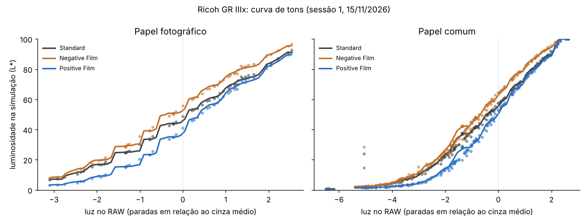
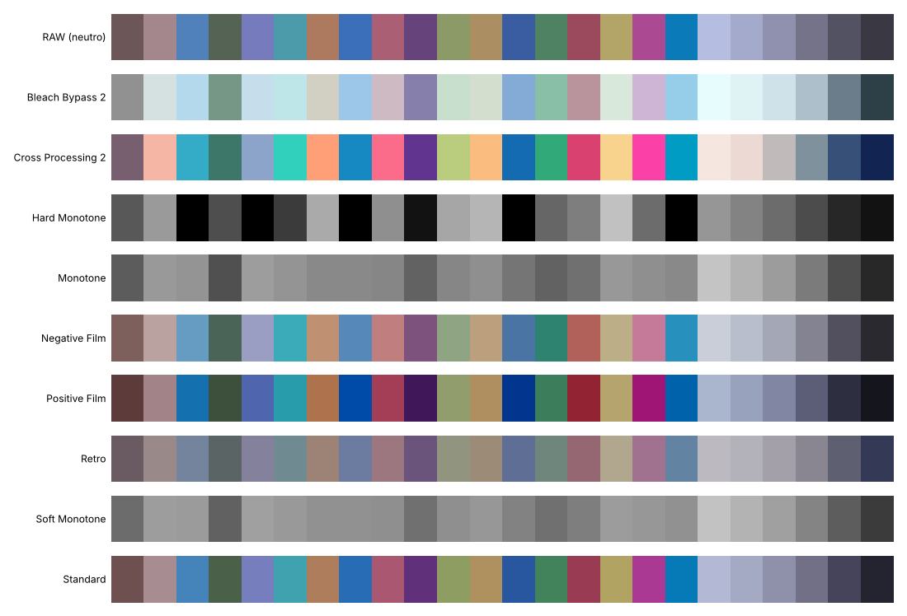

# Ricoh GR IIIx: sessão 1 (15/11/2026)

**Material:** 14 fotos RAW da cartela (série de −3 a +2 em papel fotográfico e em papel comum) e 57 simulações reveladas na própria câmera. Detalhes em [`../../anotacoes/ricoh_sessao1.md`](../../anotacoes/ricoh_sessao1.md).

**Método:** [`../../analisar_sessao.py`](../../analisar_sessao.py) liga cada simulação ao RAW de origem pelos dados internos dos arquivos, mede os 72 quadros e compara.

## Antes dos resultados: o que a impressão interfere

- **O cinza impresso não é neutro.** A HP com papel genérico deixou os cinzas levemente azul-violeta, e isso aparece no RAW e em todas as simulações. Por isso, a comparação certa é **cada simulação contra o Standard da mesma foto**: a cor da impressão e da luz se cancela.
- **Os tons de pele impressos saíram rosados** (matiz ~7° no RAW, quando uma pele real fica perto de 50°). As medidas de "pele" valem como **deslocamento relativo**, não como pele real.
- **O papel comum** tem menos saturação (26 contra 35) e pretos mais claros. Mesmo assim, **os resultados relativos se repetem nos dois papéis**, o que dá confiança na medição.
- As fotos saíram em f/2.8 e com a câmera na mão. Isso não afeta a comparação, porque cada simulação é comparada com a sua própria foto.

## Conferência pelo vídeo da tela da câmera

O vídeo da tela de informações (feito pelo fotógrafo) confirma:
- **Av, f/2.8, ISO 100, Luz do dia, sRGB, 6000×4000, 40 mm**, compensação conforme a série;
- **os parâmetros de cada simulação estão no padrão de fábrica da Ricoh**, iguais em todas as fotos (nada foi alterado sem querer).

Esses padrões **não são zero**. Cada simulação da Ricoh já vem com o seu próprio ajuste. Leitura pela ordem dos parâmetros do Image Control da GR III (saturação, matiz, tom alto/baixo, contraste, contraste das luzes, contraste das sombras, nitidez, sombreamento, clareza):

| Simulação | Tom alto/baixo | Contraste | Contraste das luzes | Contraste das sombras | Demais |
|---|---|---|---|---|---|
| Standard | 0 | 0 | 0 | 0 | 0 |
| **Negative Film** | **+1** (mais claro) | **+1** | 0 | **−1** (sombras mais suaves) | 0 |
| **Positive Film** | **−1** (mais escuro) | **+3** | −1 | **−2** | 0 |

Isso **explica as medidas abaixo**: o Negative Film sai mais claro e com sombras abertas; o Positive Film, mais escuro e bem mais contrastado. A identificação de cada ícone é a leitura mais provável pela ordem dos parâmetros; os valores conferem com o comportamento medido.

## Curva de tons

Luminosidade (L\*) de um cinza, conforme a luz que chegou ao sensor, em paradas a partir do cinza médio. Papel fotográfico:

| Simulação | −3 | −2 | −1 | **0** | +1 | +2 |
|---|---|---|---|---|---|---|
| Standard | 7 | 17 | 29 | **48** | 67 | 86 |
| **Negative Film** | 9 | 20 | 34 | **55** | 75 | 91 |
| **Positive Film** | 3 | 9 | 19 | **41** | 64 | 84 |

- **Negative Film:** mais claro nos meios-tons (+7 L\*), sombras um pouco abertas, luzes que chegam ao branco mais cedo. É o visual "negativo superexposto escaneado".
- **Positive Film:** escurece meios-tons e sombras (−7 a −10 L\*) e fecha o preto. Mais contraste, como cromo (slide).

## Equilíbrio do cinza em cada exposição (contra o Standard)

| Exposição | Negative Film: Δa\* / Δb\* | Positive Film: Δa\* / Δb\* |
|---|---|---|
| −3 | −1,4 / **+2,0** | −1,7 / +2,7 |
| −2 | −2,2 / **+3,4** | −1,6 / +2,2 |
| −1 | −1,3 / **+3,9** | −1,5 / +1,5 |
| 0 | −2,1 / **+4,9** | +0,4 / −2,0 |
| +1 | −2,7 / **+5,5** | −0,3 / −1,2 |
| +2 | −2,9 / **+7,3** | −0,6 / −0,3 |

(papel fotográfico; o papel comum mostra o mesmo padrão, um pouco mais fraco)

**O achado mais interessante:** no **Negative Film**, o cinza fica **mais amarelo e um pouco mais verde à medida que a exposição sobe** (b\* de +2 a +7; a\* de −1 a −3). É o mesmo comportamento descrito para o **Portra superexposto** ("luzes amarelo-esverdeadas", no teste da Dehancer, ver o dossiê do Portra 400). A Ricoh escolheu **manter** esse desvio como caráter do filme, em vez de neutralizá-lo.

## Cor (exposição 0, papel fotográfico)

| Simulação | Saturação (relativa ao RAW) | Desvio médio de matiz | Pele clara (matiz, relativo) | Céu (matiz, relativo) |
|---|---|---|---|---|
| Standard | 1,13 | 2° | −1° | −8° |
| **Negative Film** | **0,86** | 13° | **+20°** (mais laranja) | **−20°** (mais ciano) |
| **Positive Film** | **1,22** | 5° | +4° | −5° |
| Retro | 0,49 | 9° | | |
| Bleach Bypass | 0,47 | 40° | | |
| Cross Processing | 1,44 | 18° | | |

- **Negative Film:** menos saturado que o Standard, **pele empurrada para o laranja/dourado** e céu para o ciano. É a assinatura clássica do negativo escaneado.
- **Positive Film:** mais saturado e mais contrastado, com cores quase no lugar.

## O que isso significa para o Revela

1. **Confirma a direção dos nossos negativos:** meios-tons mais claros, saturação contida, pele mais dourada. Um fabricante de câmera chegou à mesma assinatura por outro caminho.
2. **Uma decisão para você:** o **equilíbrio automático do laboratório** (v48) neutraliza exatamente o desvio amarelo-esverdeado da superexposição, que a Ricoh preserva como caráter. Opções:
   - **(a)** manter ligado por padrão (um laboratório de verdade corrige);
   - **(b)** deixar **desligado** por padrão, mostrando o caráter "cru", como a Ricoh;
   - **(c)** usar uma **correção parcial** (por exemplo 60%): o cinza quase neutro, mas o caráter ainda aparecendo.
3. **O Positive Film é a primeira referência medida para o nosso futuro cromo:** contraste maior, preto fechado, saturação +22%.
4. **Para a próxima sessão**, a cartela precisa de cores impressas mais fiéis, sobretudo a pele: impressão em laboratório fotográfico, ou um ColorChecker de verdade.
