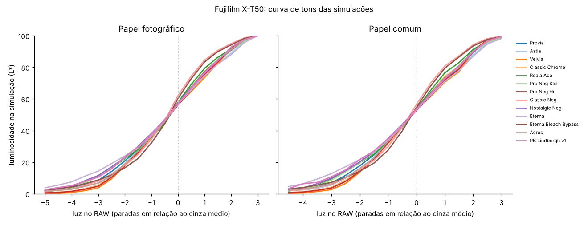
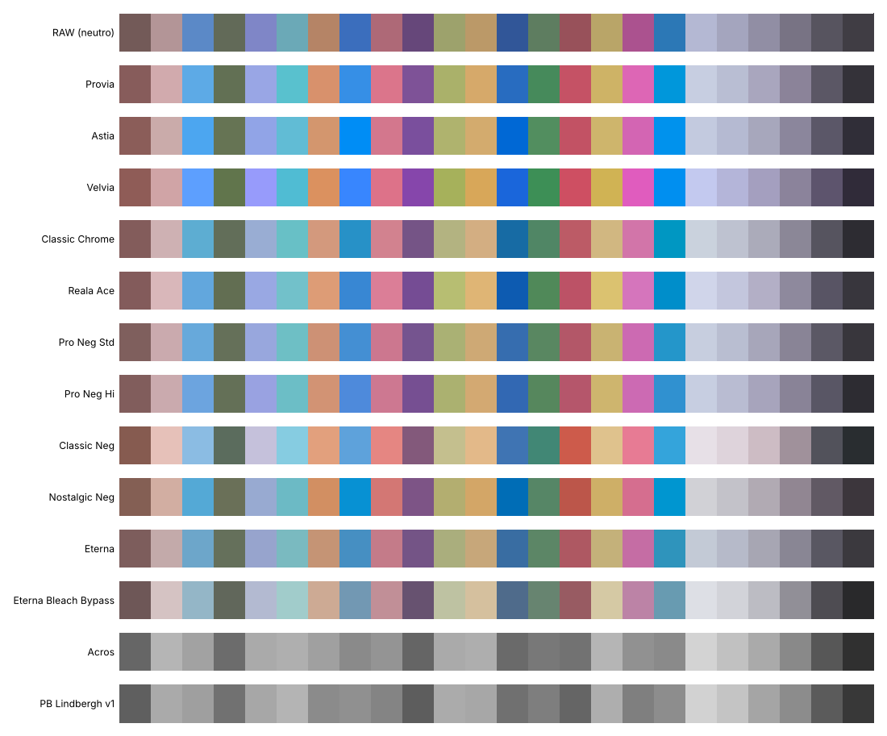

# Fujifilm X-T50: sessão 1 (15/11/2026)

**Material:** 31 RAW (`.RAF`) da cartela, compensação de −3 a +3, e as **12 simulações** da Fuji convertidas no X RAW Studio a partir desses RAW (372 JPG), mais a receita do usuário **PB Lindbergh v1** (31 JPG). Câmera: X-T50 + Viltrox 56 mm f/1.4 a f/5.6, ISO 125, DR100, Luz do dia, todos os ajustes em 0 (perfil C2, ver [`../../anotacoes/xt50_sessao1.md`](../../anotacoes/xt50_sessao1.md)).

**Método:** [`../../analisar_xt50.py`](../../analisar_xt50.py) liga cada conversão ao RAW pela hora da foto (o X RAW Studio troca os nomes), acha as cartelas no JPG Provia de cada foto e mede todas as conversões e o RAW com as mesmas marcas.

## O que a sessão tem e o que ficou de fora
- **27 das 31 fotos medidas.** DSCF0658, 0665, 0676 e 0677 saíram tremidas (câmera na mão em ~1 s) e as marcas da cartela não são encontradas.
- **Papel:** nas fotos com duas cartelas, esquerda = fotográfico e direita = comum. No começo da sessão as cartelas foram fotografadas uma de cada vez; o papel dessas fotos foi decidido pela saturação, comparada com fotos de duas cartelas de mesma exposição. A DSCF0663 (tremida) ficou ambígua (saturação 34, entre 31 e 38).
- **Referência de luz:** cinza médio do RAW na DSCF0688 (exposição 0, as duas cartelas, mesma luz).
- **O cinza impresso não é neutro** (azul-violeta, como na Ricoh). Por isso a cor é comparada **entre simulações** (ou contra o Provia), o que cancela a cor da impressão.

## Curva de tons

L\* de um cinza conforme a luz que chegou ao sensor, em paradas a partir do cinza médio. Papel fotográfico:

| Simulação | −3 | −2 | −1 | **0** | +1 | +2 | Leitura |
|---|---|---|---|---|---|---|---|
| Provia | 8,5 | 20,8 | 36,8 | **56,5** | 75,7 | 90,7 | referência |
| Astia | 6,9 | 18,8 | 36,9 | **57,5** | 74,9 | 89,0 | altas luzes mais suaves |
| Velvia | 3,8 | 17,7 | 36,9 | **56,4** | 73,5 | 91,5 | sombras mais fundas |
| Classic Chrome | 5,5 | 17,9 | 35,4 | **57,6** | 77,5 | 91,4 | mais contraste |
| Reala Ace | 11,0 | 22,2 | 35,7 | **57,9** | 79,4 | 91,8 | sombras abertas |
| Pro Neg Std | 10,8 | 22,6 | 37,5 | **56,5** | 75,7 | 90,7 | sombras abertas, suave |
| Pro Neg Hi | 4,8 | 17,6 | 36,2 | **56,2** | 75,4 | 91,5 | sombras mais fundas |
| Classic Neg | 8,0 | 17,9 | 34,5 | **62,2** | 84,6 | 95,0 | **médios e altas luzes bem mais claros** |
| Nostalgic Neg | 11,6 | 23,0 | 38,2 | **57,5** | 77,1 | 90,9 | sombras abertas |
| Eterna | 14,3 | 23,9 | 37,1 | **56,7** | 74,7 | 88,0 | **a mais plana**: sombras abertas, altas luzes contidas |
| Eterna Bleach Bypass | 8,8 | 16,4 | 32,1 | **60,3** | 83,4 | 94,2 | **a mais contrastada** |
| Acros | 6,8 | 18,9 | 36,1 | **57,1** | 76,6 | 91,3 | parecida com o Provia |
| PB Lindbergh v1 | 10,5 | 23,4 | 37,7 | **56,9** | 76,4 | 92,9 | sombras mais abertas que o Acros (Shadow −1) |

## Cor (exposição 0, papel fotográfico, DSCF0688)

| Simulação | Saturação × Provia | Desvio médio de matiz × RAW | Pele clara (matiz h, croma C) | Céu (h, C) | Folhagem (h, C) |
|---|---|---|---|---|---|
| *RAW neutro* | — | — | h 16, C 12 | h 274 | h 126 |
| Provia | 1,00 | 4,0° | h 15, C 15 | h 261, C 38 | h 129, C 18 |
| Astia | 1,03 | 3,0° | **h 26**, C 12 | h 266, C 45 | h 125, C 19 |
| Velvia | **1,25** | 2,6° | h 19, C 17 | **h 278, C 54** | h 128, **C 25** |
| Classic Chrome | 0,76 | 10,1° | h 18, C 11 | **h 242**, C 30 | h 129, C 13 |
| Reala Ace | 0,94 | 4,0° | h 14, C 13 | h 259, C 34 | h 127, C 18 |
| Pro Neg Std | 0,83 | 6,0° | h 10, C 12 | h 258, C 32 | h 128, C 15 |
| Pro Neg Hi | 0,89 | 4,1° | h 11, C 13 | h 267, C 36 | h 127, C 16 |
| Classic Neg | 0,78 | **15,2°** | **h 35**, C 15 | h 255, C 25 | **h 148**, C 11 |
| Nostalgic Neg | 0,88 | 13,0° | **h 43**, C 16 | h 249, C 33 | h 119, C 14 |
| Eterna | 0,71 | 7,2° | h 17, C 10 | h 251, C 26 | h 130, C 13 |
| Eterna Bleach Bypass | **0,46** | 10,3° | h 20, C 7 | h 238, C 14 | h 132, C 8 |

Leitura:
- **Saturação:** Velvia (+25 %) > Astia ≈ Provia > Reala > Pro Neg Hi ≈ Nostalgic > Pro Neg Std > Classic Neg ≈ Classic Chrome > Eterna > Bleach Bypass (−54 %).
- **Pele:** as simulações de negativo "de época" puxam a pele para o **amarelo-âmbar**: Classic Neg (h 35) e Nostalgic Neg (h 43), contra h 15 no Provia. A Astia também aquece a pele (h 26). Pro Neg Std/Hi deixam a pele mais **rosada** (h 10–11).
- **Céu:** Classic Chrome e Bleach Bypass levam o azul para o **ciano** (h 242/238) e tiram cor. A Velvia faz o contrário: azul mais profundo e saturado.
- **Folhagem:** a Classic Neg desloca o verde para o **ciano-verde** (h 148), assinatura dela. A Nostalgic Neg vai para o amarelado (h 119).

## Preto e branco: como cada cor vira cinza

L\* de cada quadro colorido (mesma foto):

| Quadro | Acros | PB Lindbergh v1 (Acros + filtro G) | Diferença |
|---|---|---|---|
| pele clara | 74,0 | 69,6 | **−4,4** |
| pele escura | 43,2 | 40,5 | −2,7 |
| vermelho | 48,4 | 42,8 | **−5,6** |
| amarelo | 73,7 | 71,3 | −2,4 |
| verde | 50,8 | 52,8 | +2,0 |
| folhagem | 45,6 | 47,8 | +2,2 |
| azul | 45,0 | 47,4 | +2,4 |
| céu | 67,0 | 65,7 | −1,3 |

O filtro verde faz o que a teoria diz: **escurece vermelho e pele** e clareia o verde. É isso que dá volume ao rosto na receita Lindbergh, e confirma a mistura de canais medida na emulação (R 0,10 · G 0,69 · B 0,21).

## Arquivos
- `relatorio.json`: todas as curvas, cores por quadro e o cinza de cada simulação relativo ao Provia em cada exposição.
- `curva_tons.png`, `cartela_simulacoes.png`: figuras.
